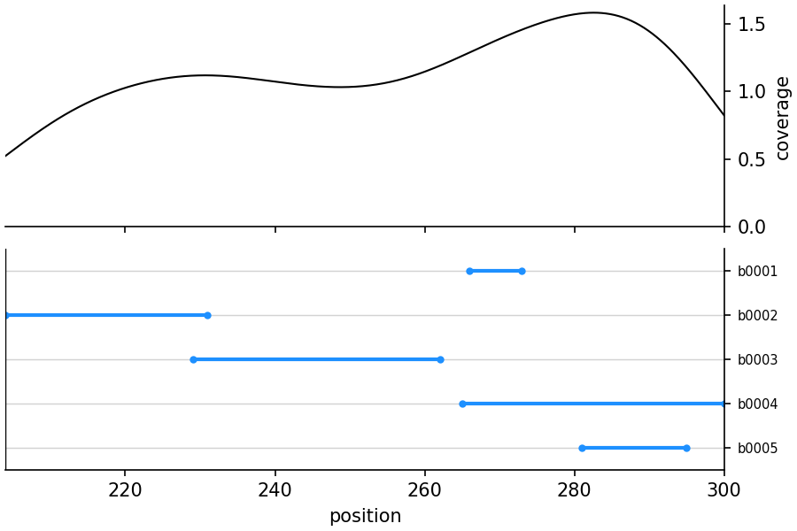

# Auxiliary Python tools

All companion tools require **Python 3.10+**. They use `argparse` for `--help`,
write results to stdout or the requested output file, and report failures on
stderr with a nonzero exit status. Existing positional arguments and option
names remain supported. CopomuS and IntaRNApvalue accept RNA/DNA literals or
one-record FASTA files; IntaRNA-fuse retains literal sequences (including N).

| Tool | Purpose | Additional dependencies |
| --- | --- | --- |
| [IntaRNA-fuse.py](#intarna-fusepy) | Combine compatible interaction sites | IntaRNA, RNAfold |
| [CopomuS.py](copomus/README.md) | Rank compensatory point mutations | IntaRNA >= 3.1.2 |
| [IntaRNApvalue](intarnapvalue/README.md) | Significance from shuffled sequences | IntaRNA; NumPy/SciPy for fits |
| [IntaRNA_CSV_p-value.py](#intarna_csv_p-valuepy) | Genome-wide energy p-values/FDRs | NumPy, SciPy |
| [IntaRNA_plotRegions.py](#intarna_plotregionspy) | Plot interaction regions | NumPy, SciPy, Matplotlib |

Run from the checkout or install all commands/modules with
`python3 -m pip install './python[plot]'` from the repository root (omit `[plot]`
if plotting is not needed). Native IntaRNA and RNAfold are installed separately.
`make install` installs the four `.py` scripts with their supporting modules;
`--enable-intarnapvalue` additionally installs the Python package using pip with
no dependency downloads. That optional hook requires pip/setuptools in the
selected Python environment. Install scientific dependencies separately for it.
For a custom prefix outside that interpreter's normal search path, add
`PREFIX/lib/pythonX.Y/site-packages` to `PYTHONPATH` when invoking IntaRNApvalue;
using `pip install` in a virtual environment avoids that manual path setup.
The optional hook does not uninstall an existing package in another prefix.

`intarna_tools.py` shares checked command execution, executable lookup, input
validation and atomic output between the scripts. Keep it beside scripts when
copying them manually; keep `copomus/` beside `CopomuS.py` as well. Installed
Python packages include the helper automatically. Imports perform no predictions.

## Output analysis and visualization

The former R tools are now standalone Python scripts in this folder. Replace
`Rscript --vanilla IntaRNA_CSV_p-value.R` with
`python3 IntaRNA_CSV_p-value.py`, and `Rscript --vanilla IntaRNA_plotRegions.R`
with `python3 IntaRNA_plotRegions.py`. Positional arguments are unchanged.
R and the R packages ggplot2, ggalt and cowplot are no longer needed.

### Dependencies and installation

Both scripts require **Python 3.10 or newer** and **NumPy >= 1.23**,
**SciPy >= 1.9**; plotting additionally requires **Matplotlib >= 3.6**.
From the repository root, install these optional dependencies in your Python
environment:

```bash
python3 -m pip install -r python/requirements-output-tools.txt
```

Run the scripts directly from the checkout as shown below. `make install` also
installs both executable `.py` scripts in the configured `bin` directory; their
`#!/usr/bin/env python3` interpreter must have the dependencies installed.
Autotools does not install these Python dependencies. They are optional for the
C++ IntaRNA predictor. The fitted CSV and shuffled-sequence workflows have separate statistical models,
although they are distributed together by the Python package.

### `IntaRNA_CSV_p-value.py`

Estimate p-values for a **genome-wide** target screen from its observed energy
distribution. A sufficiently large and diverse collection of target energies is
required to serve as a background. This is not a significance test calibrated
for a small selection of interactions or a single target/query pair.

The script reads semicolon-separated IntaRNA CSV, fits a generalized extreme
value (GEV) distribution to the **negated** energies by maximum likelihood, and
appends `p-value` and `fdr` columns. More negative energies receive smaller
p-values. FDRs use the Benjamini-Hochberg correction over all input rows. As in
the former script, p-values are rounded to seven decimal places **before** the
correction, and FDRs are also written with seven decimal places.

```bash
# Overwrite the input only after successful validation and fitting.
python3 python/IntaRNA_CSV_p-value.py IntaRNA-output.csv
# Write a separate output file.
python3 python/IntaRNA_CSV_p-value.py IntaRNA-output.csv IntaRNA-output-with-pValue.csv
# Fit an existing custom energy column.
python3 python/IntaRNA_CSV_p-value.py IN.csv IN-pValue.csv E_norm
```

The default energy column is `E`. All original field values, column names and
row order are retained; fields containing semicolons or quotes are CSV-quoted.
Empty tables, fewer than three distinct energies, missing/duplicate columns,
nonfinite or nonnumeric energies, malformed rows, existing `p-value`/`fdr`
columns and unsuccessful fits are errors. The distinct-value check is a numerical
minimum, not a guarantee of a statistically adequate background. Errors leave
existing output files untouched.

SciPy uses the opposite GEV shape sign to the old R/evir convention
(`c = -xi`); the script accounts for this and evaluates the survival function
of the negated energies. This also handles the zero-shape Gumbel limit and
extreme tails. The statistical model and initial estimates are retained, but
SciPy's optimizer and convergence tolerances can produce slightly different
fitted values from R; outputs are not guaranteed to match digit for digit.
See [SciPy's GEV documentation](https://docs.scipy.org/doc/scipy/reference/generated/scipy.stats.genextreme.html).

### `IntaRNA_plotRegions.py`

Visualize the regions covered by IntaRNA interactions in two aligned panels:
smoothed nucleotide coverage above and one blue interval per interaction below.
The first CSV row appears at the top. Repeated IDs remain separate rows. Both
interval endpoints are included in the coverage calculation; signed coordinates
and intervals specified in reverse order are supported.

Arguments, in order:

1. Semicolon-separated IntaRNA CSV containing `id1,start1,end1` or
   `id2,start2,end2`.
2. `1` for target regions, `2` for query regions, or a parameter-file path.
3. Output filename ending in `.pdf`, `.png`, `.svg`, `.eps`, `.ps`, `.jpeg`
   or `.tiff`.

```bash
python3 python/IntaRNA_plotRegions.py python/examples/regions.csv 1 regions.png
python3 python/IntaRNA_plotRegions.py python/examples/regions.csv 2 query-regions.svg
python3 python/IntaRNA_plotRegions.py python/examples/regions.csv python/examples/regions.params query-regions.pdf
```

The [example CSV](examples/regions.csv) produces:



By default, the first **200** interactions are plotted. A parameter file accepts
one `key = value` assignment per line, whitespace, blank lines and `#` comments.
`id`, `start` and `end` are required CSV column names; all other keys are optional:

| Key | Meaning | Default |
| --- | --- | --- |
| `id` | CSV column used for row labels | Required |
| `start` | CSV column for integer interval starts | Required |
| `end` | CSV column for integer interval ends | Required |
| `title` | Title above the coverage panel | No title |
| `xvline` | Vertical reference position in both panels | None |
| `xmin` | Left x-axis limit | Smallest covered position |
| `xmax` | Right x-axis limit | Largest covered position |
| `rows` | Positive maximum number of interactions | 200 |

An example is provided in [examples/regions.params](examples/regions.params).
Blank or `NA` values for optional x positions use the defaults. The coverage
curve uses a Gaussian kernel with R's original `bw.nrd0` bandwidth rule, scaled
by the number of covered bases (a smoothed count, not a fraction). As in the R
plot, x limits filter coverage samples before estimating the curve. Matplotlib
replaces the R graphics backend, so fonts, margins and density interpolation
can differ. Plots are generated without a graphical display.

### Tests

After installing the optional dependencies, run from the repository root:

```bash
python3 -m unittest discover -s python/tests -v
```

In a configured build, `make -C python check-python-tools` runs the same tests
(`check-output-tools` remains an alias).
They cover GEV formulas and known-distribution fitting, BH correction, CSV
preservation and errors, every plot format, mutation coordinates/ranking/profiles,
shuffled sampling and failure handling. Native smoke tests run when IntaRNA is
available. CI checks minimum/current scientific dependencies on Python 3.10/3.13,
installed command entry points, and native behavior in the C++ build matrix.

## [IntaRNA-fuse.py](IntaRNA-fuse.py)

Computes non-overlapping interaction sites and tests whether each suboptimal
site can coexist with the minimum-free-energy (MFE) interaction. It reruns
IntaRNA with the suboptimal site blocked on both strands. If the resulting MFE
overlaps the original MFE by at least two nucleotides on **each** strand, it
reports a fused interaction using the suboptimal site and that constrained MFE.
This preserves the compatibility criterion of the former Perl script.

Requires Python 3.10 or newer (standard library only), IntaRNA, and ViennaRNA's
`RNAfold`. `make install` installs `IntaRNA-fuse.py` alongside `IntaRNA`; no pip
installation or `--enable-intarnapvalue` is needed. The script looks for
executables beside itself and on `PATH`, and also checks `../src/bin/IntaRNA`
when run from the source tree. For an out-of-tree build, add its `src/bin`
directory to `PATH`. Make `RNAfold` available on `PATH` or beside the script.

```bash
# Installed script; -t is the target (seq1), -q is the query (seq2).
IntaRNA-fuse.py -t GGGGGGGAAAAAGGGGGGG -q CCCCCCCAAAAACCCCCCC -n 3

# From a built source checkout:
python3 python/IntaRNA-fuse.py -t GGGGGGGAAAAAGGGGGGG -q CCCCCCCAAAAACCCCCCC
```

The command replaces `perl/IntaRNA-fuse.pl`. Both `-t` and `-q` are required
literal sequences (A/C/G/U/T/N, case insensitive); FASTA files and multiple
sequences are not supported. Unlike the Perl prototype, supplied sequences are
used as given instead of being overwritten with an example pair.

| Option | Meaning | Default |
| --- | --- | --- |
| `-n` | Maximum number of original predictions, including the MFE; positive integer | `10` |
| `-l` | Maximum intramolecular base-pair span for both IntaRNA and RNAfold; positive integer | `100` |
| `-o` | Comma-separated CSV column names | `E,start1,end1,start2,end2,ED1,ED2,E_init,hybridDB` |
| `-h` | Show help without requiring either executable | |

`-o` must include `E,start1,end1,start2,end2,ED1,ED2,E_init`, in any order.
Additional IntaRNA CSV columns are passed through. Output is semicolon-separated
CSV on stdout, beginning with the original MFE and then each suboptimal row.
A compatible suboptimal row is immediately followed by its fused row. In that
row, `E`, `ED1`, and `ED2` describe the combined interaction; all other fields
contain `suboptimal:constrained-MFE` values. Coordinates are 1-based and
inclusive, in the original orientation of each input sequence. Fused rows are
additional to the `-n` predictions and are not re-sorted by energy. No original
predictions produces just the CSV header; no constrained prediction means no
fused row for that candidate.

For each strand, RNAfold computes its ensemble free energy with both sites
forced unpaired. The difference from the unconstrained ensemble gives the joint
accessibility cost `ED1` or `ED2`. The fused energy (all terms in kcal/mol) is:

```text
E_fused = (E_suboptimal - ED1_suboptimal - ED2_suboptimal)
        + (E_constrained_MFE - ED1_constrained_MFE - ED2_constrained_MFE)
        + ED1_joint + ED2_joint
```

As in the Perl implementation, this retains both interaction initiation terms;
it does not subtract an `E_init` term. Single-strand ensemble energies use
RNAfold's printed precision. This pairwise compatibility check does not search
all combinations of sites or optimize a full multi-site structure. Invalid
input, missing executables, failed commands, or malformed energy/CSV output
produce a nonzero exit status and a diagnostic on stderr, with no result CSV.

## [IntaRNApvalue](intarnapvalue)

Calculate p-values using energies from **shuffled sequences**. This is a
separate workflow from fitting an existing genome-wide CSV with
`IntaRNA_CSV_p-value.py`; see its own dependency and usage documentation.

## [CopomuS](copomus)

The Compensatory Point Mutation Selector helps identify promising base pairs
from an IntaRNA MFE prediction for validation through compensatory mutation
experiments. See its own dependency and usage documentation.
