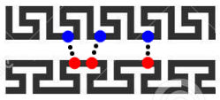

# CopomuS - Compensatory point mutation selector for sRNA-RNA interaction verification



## How it works

CopomuS is a tool for selecting mutation candidate points for sRNA-RNA interactions.
For this it takes different measures for evaluating and ranking each position.
CopomuS is highly configurable for specific purposes, see below for an explanation of all arguments.

## Overview
- [Dependencies](#dependencies)
- [Usage](#usage)
- [Arguments](#arguments)
    - [Measures](#measures)
    - [Candidate Selection](#candidate-selection)
    - [Candidate Filters](#candidate-filters)
    - [Mutation Generators](#mutation-generators)

## Dependencies
- [IntaRNA](https://github.com/BackofenLab/IntaRNA) >= 3.1.2 (beside the installed scripts, in `src/bin`, or on PATH)
- [python](https://www.python.org/) >= 3.10

## Usage
```console
python3 python/CopomuS.py -q <query-sequence> -t <target-sequence>

mutation	rank	qIndex	tIndex	bpWildtype	bpMutated	mfeCover_rank	mfeCover_ww	mfeCover_wm	mfeCover_mw	mfeCover_mm	mfeCover_is_valid	E_rank	E_ww	E_wm	E_mw	E_mm	E_is_valid	minDeltaE_rank	minDeltaE_wm/ww	minDeltaE_mw/ww	minDeltaE_wm/mm	minDeltaE_mw/mm	minDeltaE_ww/mm	minDeltaE_min
U4A&A11U	1	4	11	UA	AU	1	True	False	False	True	1	1	-9.32	-5.43	-7.25	-8.46	1	3	3.89	2.07	3.03	1.21	-0.86	1.21
C16G&G1C	2	16	1	CG	GC	1	True	False	True	True	1	2	-9.32	-8.11	-5.31	-5.99	0	5	1.21	4.01	-2.12	0.68	-3.33	-2.12
G15C&C2G	2	15	2	GC	CG	1	True	True	False	True	1	2	-9.32	-12.37	-8.12	-12.2	0	5	-3.05	1.2	-0.17	4.08	2.88	-3.05
...
```

## Arguments

| Flag                | Value                  | Default | Description          |
| :------------------ |:---------------------- | :------ | :-------------------- |
| -h, --help          |                        |         | Gives detailed command help. |
| -q, --query         | sequence or FASTA               |         | Query as RNA/DNA or a single-record FASTA file. |
| -t, --target        | sequence or FASTA               |         | Target as RNA/DNA or a single-record FASTA file. |
| -m, --measure       | {E, minDeltaE, mfeCover, Eqi, Eti, EDqi, cEDqi} | mfeCover, E, minDeltaE | The measure used to calculate the rank of a base pair. Can be used multiple times. In that case, base pairs are ranked in order of measurements specified. |
| --qIdxPos0          | integer                | 1       | (Optional) starting index for the query. |
| --tIdxPos0          | integer                | 1       | (Optional) starting index for the target. |
| -s, --candidateSelection | {mfe, mfeSO}      | mfe     | (Optional) method by which base pair candidates are selected from the sequences. |
| -f, --candidateFilter | {GU, AU, CG, GC, lp, lpMfe, he, heMfe} | None     | (Optional) filter by which base pair candidates are filtered. Can be used multiple times to combine filters. |
| -g, --generator     | {flip, any}            | flip    | (Optional) method used to generate mutated sequences by which base pairs are ranked. |
| --mutationEncoding  | string (ex. G1C&U7G)   |         | (Optional) allows specific selection of candidates by specifying a mutation encoding. If this option is specified, -s, -f and -g will be ignored. |
| -o, --output        | file name              | STDOUT  | (Optional) file to which the output should be written to. |
| -d, --delimiter     | character              | "\t" (tab) | (Optional) delimiter used to separate csv output. |
| -p, --parameterFile | file name              | None    | (optional) parameter file to be used in IntaRNA calls to further guide predictions. |
| --threads       | integer                | 0 (all) | (Optional) thread count used by IntaRNA. |

Input sequences are normalized to uppercase RNA. FASTA files must contain exactly
one nonempty record; wrapped lines are supported. Negative indexing skips zero,
as in IntaRNA; `--qIdxPos0=0` / `--tIdxPos0=0` explicitly use zero-based indexing.
Mutation encodings are query-first, e.g. `G1C&C2G`, and comma-separated for multiple
candidates. Positions must lie inside the sequences, wildtype bases must match,
and both bases must change. Quote encodings in the shell because they contain `&`.
`GC` and `CG` are aliases for the same filter.

Output is tab-separated UTF-8 with LF line endings by default. Numeric zero is a
valid score; unavailable scores are `NA`. Errors go to stderr with nonzero status.
An output file is replaced only after all predictions and rankings succeed.
Temporary profiles are private to one invocation, shared between measures, and
cleaned up on success or failure. All candidates reuse one wildtype prediction.
For example, from the repository root:

```bash
python3 python/CopomuS.py -q query.fa -t target.fa -m EDqi -m cEDqi -m Eqi -o mutations.tsv
python3 python/CopomuS.py -q GC -t GC --mutationEncoding 'G1C&C2G' -m E
```

#### Measures

| Name  | Description                                 |
| :---- | :-------------------------------------------|
| E     | (class) Interaction Energy between query and target. |
| minDeltaE | (sort) Minimum of wm−ww, mw−ww, wm−mm and mw−mm; larger is better, including zero/negative values. |
| mfeCover | (class) Mutation position has to be in MFE. |
| Eqi   | (class) Energy profile on query at mutation position. |
| Eti   | (class) Energy profile on target at mutation position. |
| EDqi  | (sort) Accessibility profile on query at mutation position. |
| cEDqi  | (class) Accessibility profile on query at mutation position needs to be constant. |

The default measure combination is `-m mfeCover -m E -m minDeltaE`.
It is advised to always use a sorting measure at the end, to improve the resolution of the result,
since class measures only split mutations in 3 ranks (valid, invalid, no more interaction).

#### Candidate Selection
The choice specified by this argument defines the method, which is used to select candidate base pairs from the given sequences.

| Name  | Description                                 |
| :---- | :-------------------------------------------|
| mfe   | Selects all base pairs from the MFE region. |
| mfeSO | Selects all base pairs from all suboptimal interactions that are in the MFE region. |

#### Candidate Filters
The filters filter out base pairs from all candidates that do not comply with the constraints.

| Name  | Description                                 |
| :---- | :-------------------------------------------|
| GU    | Filters out any GU or UG base pairs.        |
| AU    | Filters out any AU or UA base pairs.        |
| GC    | Filters out any GC or CG base pairs.        |
| lp    | Filters lonely base pairs that can not stack (both neighbors not in MFE and both neighbors cant pair). |
| lpMfe | Filters lonely base pairs in MFE interaction (both neighbors not in MFE). |
| he    | Filters helix ends (One neighbor can pair, the other one can not). |
| heMfe | Filters helix ends (One neighbor in MFE, the other one is not). |

#### Mutation Generators
The mutation generator chooses the method by which mutated sequences are generated.

| Name  | Description                                 |
| :---- | :-------------------------------------------|
| flip  | Flips a base pair to generate the mutated sequences (for example GC --> CG) |
| any   | Generates all logical base pair combinations from a given base pair (for example GC --> CG, UG, UA) |